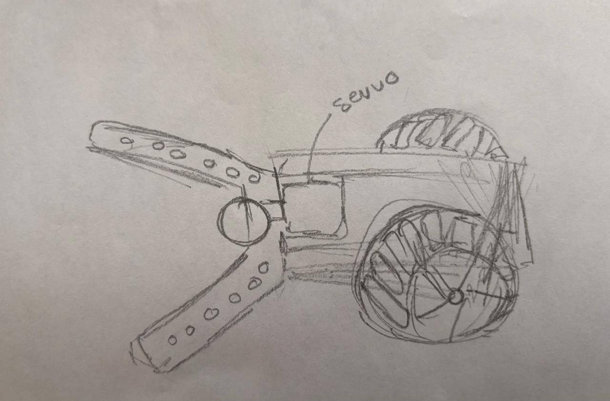

# Práctica 1: Propuesta y Diseño del Carrito Futbolista (Mecánica y Actuación)

> **Asignatura:** Introducción a Mecatrónica  

---

## 🎯 Objetivo General

Plantear la propuesta de diseño mecánico de un carrito controlado para jugar fútbol, integrando paredes colectoras frontales para guiar y retener la pelota, y un mecanismo de pateo accionado por un servomotor que permita golpear el balón con precisión.

---

## 📋 Lista de Entregables

- [x] **1. Propuesta de Diseño Estructural:** Esquema conceptual y distribución geométrica del carrito con paredes colectoras en forma de embudo.
- [x] **2. Mecanismo de Pateo (Actuador):** Integración de un servomotor acoplado a una palanca de impacto para el golpeo del balón.
- [x] **3. Análisis de Espacios y Dimensiones:** Distribución de las partes para no exceder las dimensiones propuestas (20x20).
- [x] **Evidencia:** Bocetos de diseño y diagramas conceptuales.
- [x] **Conclusión:** Resumen de la propuesta mecánica.

---

## 1. 📐 Fundamento Teórico

1. **Diseño de Paredes:**  
   Para facilitar el control del balón sin necesidad de un mecanismo de agarre complejo, se diseñan paredes laterales inclinadas en la parte frontal del carrito. Esto crea una geometría que canaliza la pelota hacia el centro de la estructura conforme el carrito avanza, asegurando que el balón se mantenga alineado frente al mecanismo de pateo.

2. **Mecanismo de Pateo por Palanca y Servomotor:**  
   El pateo se realiza mediante una palanca conectada al eje de un servomotor. Al girar el servo a una posición específica (por ejemplo, de 0° a 180°), la palanca impacta el balón con una velocidad angular controlada, transfiriendo momento lineal para realizar el disparo.

3. **Estabilidad y Distribución de Masas:**  
   Es fundamental ubicar los componentes más pesados (como la batería y los motores) en la parte inferior y central del chasis para mantener un centro de gravedad bajo y evitar que el vehículo se levante o vuelque.

---

## 2. 🛠️ Elementos del Diseño Propuesto

- **Chasis principal:** Plataforma base para montar la circuitería y los motores de tracción.
- **Paredes frontales/laterales:** Barreras guía diseñadas para retener el esférico.
- **Palanca de disparo:** Brazo mecánico solidario al cuerno del servomotor SG90.
- **Ubicación del balón:** Zona de retención frontal previa al impacto.

---

## 3. 🧪 Desarrollo de la Propuesta

### Práctica 1: Estructura de Paredes Colectoras y Mecanismo de Pateo
- **Descripción:** Se diseña una estructura frontal en V o en cuña abierta con paredes laterales que actúan como guías pasivas, impidiendo que la pelota se desvie hacia los costados. Adicionalmente, se posiciona un servomotor SG90 en la parte central-delantera con un brazo de palanca acoplado a su eje para ejecutar el disparo mediante un barrido angular rápido.

---
## 4. Fotos
{loading=lazy}

## 📝 Conclusiones

- La propuesta de diseño mecánico basada en paredes colectoras simplifica considerablemente el control del balón, permitiendo al carrito conducirlo sin sistemas complejos de sujeción activa.
- La incorporación de un servomotor como mecanismo de pateo ofrece una solución compacta, precisa y fácil de programar para la acción ofensiva del robot en el partido de fútbol.