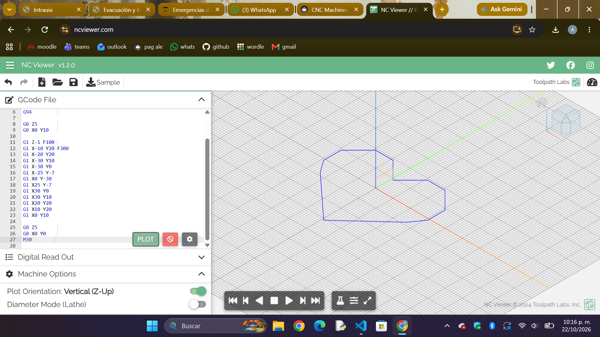

# 🦋 Reporte de Proyecto: Diseño y Maquinado CNC

## 📋 Información General

* **Proyecto:** Pieza de Mariposa en Maquinado CNC
* **Tecnología de Fabricación:** Fresadora Automática CNC
* **Software Cam/Preparación:** VCarve Pro
* **Formato de Entrada Vectorial:** `.DXF`
* **Material:** Espuma rosa

---

## 1. 💡 Introducción 

El objetivo de este proyecto consistió en fabricar/esculpir una **mariposa** utilizando una fresadora automática CNC. A diferencia del corte láser, la CNC utiliza un proceso mediante una herramienta de corte giratoria (fresa), lo que requiere una preparación especial en los recorridos y profundidades.

Para este proyecto, partimos de un diseño vectorial en formato `.DXF` con la silueta y los detalles internos de las alas de la mariposa.
--- 

## Práctica previa en NCViewer:

Como paso previo al maquinado real, realizamos una simulación digital en NCViewer para comprender la estructura del código G (G-code) y visualizar la trayectoria de la herramienta (toolpath). Esta práctica nos permitió verificar los movimientos de la fresadora CNC, corregir posibles colisiones y asegurar la correcta generación del programa antes de pasar a la máquina física.

{loading=lazy}

---

## 2. 💻 Preparación del Archivo en VCarve Pro

Para adaptar el archivo vectorial a la máquina CNC, utilizamos el software **VCarve Pro**, siguiendo estos pasos clave:

1. **Importación del DXF:** Cargamos el vector `.DXF` de la mariposa en el espacio de trabajo.
2. **Definición del Material (Setup):**
   * Configuración de las dimensiones del bloque ($X, Y, Z$).
   * Establecimiento del punto de origen ($Z$-zero) en la superficie de la pieza.
3. **Acomodo y Anidado:** Orientamos y posicionamos el vector para optimizar el área de corte y asegurar que la herramienta tenga espacio de maniobra libre.
4. **Asignación de Trayectorias de Herramienta:**
   * **V-Carving** Para los detalles internos y el grabado estético de las alas.
   * **Perfilado:** Para el corte exterior del contorno de la mariposa.
5. **Generación de Puentes de Sujeción (*Tabs*):** Añadimos pequeñas pestañas de soporte para evitar que la mariposa se suelte o salga proyectada al terminar de cortar el contorno.

---

## 3. ⚙️ Configuración del Maquinado

En VCarve Pro especificamos los parámetros de corte según la broca seleccionada:

* **Tipo de fresa:** Fresa recta (o V-Bit para detalles de grabado).
* **Velocidad de Avance:** Velocidad a la que se desplaza la máquina horizontalmente.
* **Velocidad de Pasada:** Velocidad de bajada de la broca en el eje $Z$.
* **Profundidad de Pasada:** Cálculo de capas para no sobrecargar la fresa en un solo paso.

> **Nota técnica:** Exportamos el archivo desde VCarve Pro transformándolo en el código de lenguaje de máquina (**G-Code**) compatible con la fresadora CNC.

---

## 4. 🛠️ Maquinado, Ajustes y Resultado Final

Una vez configurada la fresadora (fijación del material a la mesa de trabajo y calibración del punto cero $X, Y, Z$):

1. **Ejecución del G-Code:** La CNC ejecutó primero los grabados interiores de las alas y posteriormente el perfilado exterior.
2. **Retiro de Pestañas (*Tabs*):** Una vez concluido el ciclo de maquinado, retiramos manualmente las pestañas de soporte mediante una herramienta manual (cutter) y segueta.
3. **Resultado:** Se obtuvo una pieza sólida de mariposa.

---

## 📊 Resumen del Proceso

| Etapa | Actividad Principal | Herramientas Utilizadas |
| :--- | :--- | :--- |
| **1. Diseño Vectorial** | Creación y exportación de la mariposa en vector | Software CAD (`.DXF`) |
| **2. Cam & Layout** | Importación, acomodo, asignación de *toolpaths* y *tabs* | VCarve Pro |
| **3. Post-Procesado** | Generación del código de máquina de corte | Código `G-Code` |
| **4. Maquinado CNC** | Fijación, calibración de origen y desbaste | Fresadora Automática CNC |
| **5. Acabado** | Remoción de pestañas de sujeción y acabado final | Herramientas manuales  |

---
## FOTOS
.jpeg){loading=lazy}
.jpeg){loading=lazy}
.jpeg){loading=lazy}
.jpeg){loading=lazy}

---
## 🎯 Conclusión

El uso de **VCarve Pro** fue fundamental para traducir la idea vectorial de la mariposa en instrucciones de movimiento tridimensionales para la fresadora CNC. Comprender la diferencia entre trayectorias de perfilado, cajeras y la importancia de los *tabs* garantizó un proceso seguro, sin colisiones y con un acabado estético de gran calidad.