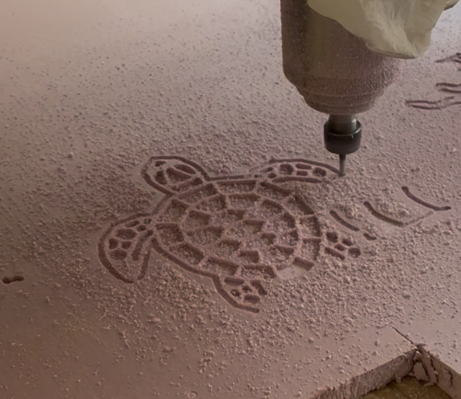

# Reporte de Práctica: Preparación CAM en VCarve Pro y Maquinado en Router CNC Industrial

**Institución:** Universidad Iberoamericana Puebla  
**Departamento:** Ingenierías / Mecatrónica  
**Asignatura:** Proyectos de Ingeniería  
**Ubicación:** Instituto de Diseño e Innovación Tecnológica (IDIT) - Taller de CNC  
**Supervisión Académica:** Mtro. Oliver Ochoa  
**Integrantes del Proyecto:** Roberto Alejandro y Colaboradores  
**Software CAM:** VCarve Pro  
**Equipo de Maquinado:** Router CNC Asia Robótica (Modelo AR-1325)  

---

## 1. Objetivos

* **General:** Preparar, configurar y ejecutar el maquinado CNC de un modelo vectorial tridimensional (tortuga) mediante el software CAM VCarve Pro y el router CNC industrial Asia Robótica.
* **Específicos:**
  1. Importar archivos vectoriales en formato `.DXF` a VCarve Pro, verificando el cierre de vectores, dimensiones de la pieza y alineación en el plano de trabajo.
  2. Configurar trayectorias de herramienta de **Perfilado** y **Cajeado (Pocketing)**, definiendo profundidades de corte, diámetros de fresa y velocidades.
  3. Exportar el código G posprocesado (`.nc`) a una memoria USB mediante la configuración adecuada de posprocesador (`AsiaRobotica-NK105`).
  4. Operar el Router CNC Asia Robótica AR-1325, comprendiendo el protocolo de encendido, uso de la cama de sacrificio, fijación mecánica mediante prensas/clamps, montaje de herramienta en el collet, tarado de ejes ($X, Y, Z$) y activación del sistema de aspiración/limpieza de viruta.

---

## 2. Marco Teórico y Software VCarve Pro

El maquinado por Router CNC se divide en dos fases indispensables: la **fase CAM (Computer-Aided Manufacturing)** y la **fase de ejecución en máquina**.

### A. Preparación y Funciones Clave en VCarve Pro
* **Importación `.DXF` y Cierre de Vectores:** Al importar geometrías externas, VCarve permite identificar trazos abiertos y unificarlos con la herramienta *Join Vectors* (Unir vectores). Vectores abiertos impiden generar operaciones de cajeado o perfilado cerrado.
* **Dimensionado del Material:** Se definen las dimensiones exactas del bloque ($X, Y, Z$) y el origen del punto cero (usualmente esquina inferior izquierda y superficie superior del material).
* **Cajeado (Pocketing / Machining):** Operación donde la herramienta remueve el material contenido dentro de un contorno cerrado hasta alcanzar una profundidad calculada ($Z$), dejando cavidades limpias.
* **Perfilado (Profiling):** Trayectoria que sigue el contorno interior, exterior o sobre el vector para realizar el corte completo de la silueta o el marcado de aristas.
* **Posprocesado (`.nc`):** Traducción de las trayectorias virtuales a código numérico comprensible por el controlador DSP/NK105 de la máquina CNC.

---

## 3. Descripción de Evidencias e Imágenes de la Práctica

A continuación se detalla la secuencia del proceso mediante las fotografías y videos capturados durante la sesión de laboratorio:

### Figura 1: Importación Vectorial y Cierre de Vectores en VCarve Pro
Muestra la interfaz de trabajo de VCarve Pro con el vector de la tortuga importado desde un archivo `.DXF`. Se verifica la escala del material (aislante de poliestireno extruido / espuma rígida) y el cierre perfecto de los contornos para permitir las operaciones de cajeado en las secciones del caparazón y extremidades.

*Figura 1: Organización de vectores y verificación de aristas cerradas para la tortuga en VCarve.*

---

### Figura 2: Configuración de Trayectorias y Exportación de Código G
Muestra el panel *Trayectorias de herramientas* de VCarve. Se aprecian las operaciones configuradas: **Perfilado 1** y **Cajeado 1**. En el panel superior se selecciona el posprocesador específico de la máquina: **`AsiaRobotica-NK105.3-arcs (*.nc)`** para guardar las trayectorias directamente en la memoria USB.

*Figura 2: Selección de operaciones (Perfilado/Cajeado) y exportación posprocesada para la controladora Asia Robótica.*

---

### Figura 3: Fijación del Material y Cama de Sacrificio
Muestra el detalle del área de trabajo del router CNC Asia Robótica AR-1325. Se observa la **cama de sacrificio** de MDF en la parte inferior, sobre la cual se coloca la placa de poliestireno rosa. La pieza se asegura rígidamente utilizando un clamp o prensa de sujeción mecánica sobre el riel en T (*T-slot*) para evitar vibraciones o desplazamientos durante el maquinado.

*Figura 3: Sistema de fijación con clamp sobre el riel en T y la cama de sacrificio del router CNC.*

---

### Figura 4: Explicación del Equipo y Protocolo por el Mtro. Oliver Ochoa
El Mtro. Oliver Ochoa explica el funcionamiento general de la mesa de maquinado del Router CNC Asia Robótica AR-1325, señalando los límites de carrera de los ejes $X, Y, Z$, el área de sujeción y el uso de los controles del panel principal.

*Figura 4: Explicación previa a la puesta en marcha sobre el Router CNC Asia Robótica AR-1325.*

---

### Figura 5: Montaje de la Fresa y Ajuste del Collet
Estudiantes realizando el montaje de la fresa de corte en el husillo (spindle). Se observa el proceso de inserción del collet/boquilla y el apriete mecánico mediante la llave para asegurar que la herramienta no sufra desalineamiento o soltura bajo carga.

*Figura 5: Procedimiento de ajuste de la herramienta en el husillo del router CNC.*

---
### Figura 6: Terminado de tortuga
Se muestra una imagen de la maquinaria realizando el terminado final de la figura que agregamos previamente en archivo dxf.

*Figura 5: Tortugadxf.*

## 4. Resumen del Protocolo de Operación del Router CNC

| Etapa | Operación Clave | Equipo / Componente |
| :--- | :--- | :--- |
| **1. Diseño CAM** | Cierre de vectores, cajeado y perfilado | Software VCarve Pro |
| **2. Posprocesado** | Exportación de archivo `.nc` | Posprocesador `AsiaRobotica-NK105` en memoria USB |
| **3. Encendido y Calibración** | Puesta en marcha y posicionamiento de orígenes ($X_0, Y_0, Z_0$) | Control DSP / Controladora NK105 |
| **4. Fijación del Material** | Presión mecánica sobre la cama de sacrificio | Clamps / Prensas sobre riel T-slot |
| **5. Herramental** | Ajuste de fresa con collet y apriete manual con llave | Husillo (Spindle) refrigerado |
| **6. Ejecución y Limpieza** | Activación del spindle y extractor de viruta | Sistema de aspiración del IDIT |

---

## 5. Conclusiones

* La correcta gestión digital en VCarve Pro (cierre de vectores y aplicación de offset/cajeado) es indispensable para evitar colisiones de la herramienta o maquinados incompletos.
* La utilización de la cama de sacrificio garantiza que las herramientas penetren completamente el grosor de la pieza en operaciones de perfilado sin dañar la estructura de aluminio del router.
* La práctica permitió consolidar el flujo completo de ingeniería de manufactura asistida por computadora (CAD-CAM-CNC), logrando un producto final (tortuga) con excelente calidad superficial y tolerancias geométricas exactas.